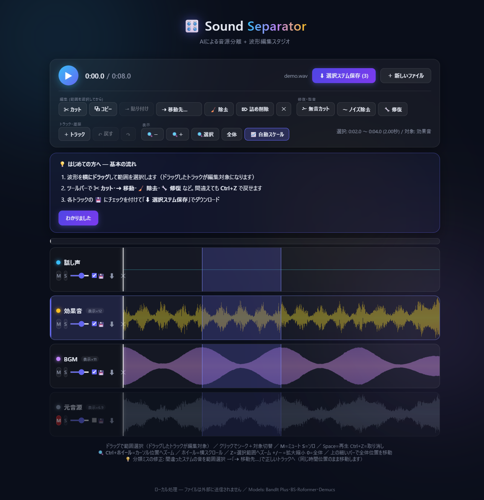
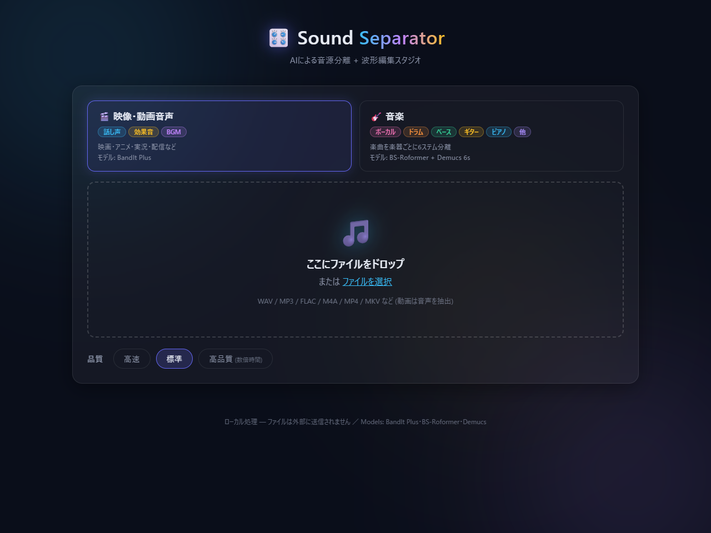
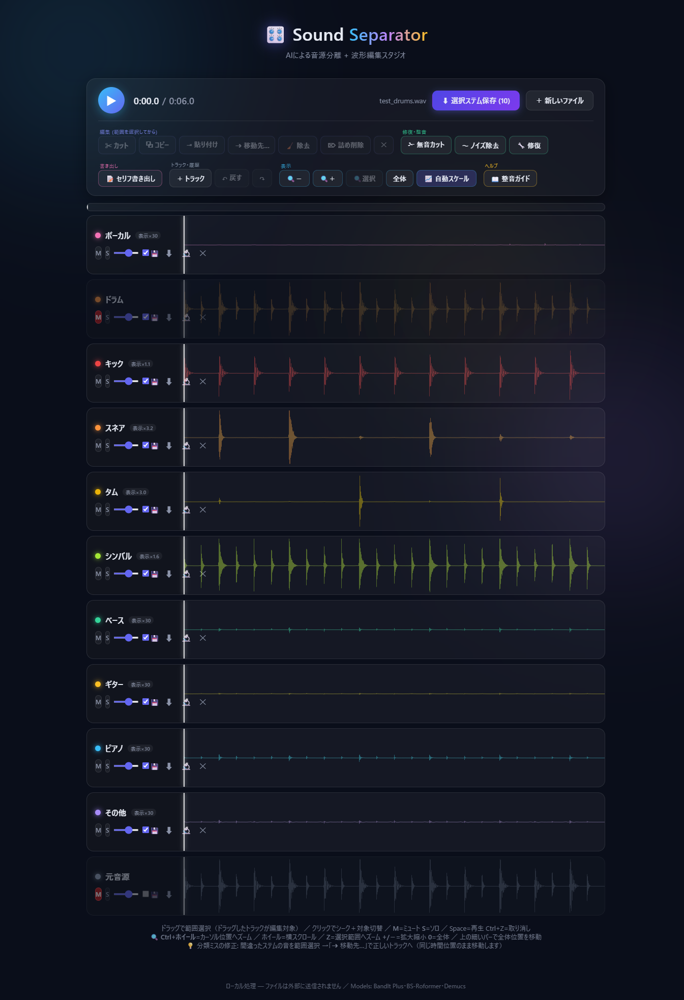
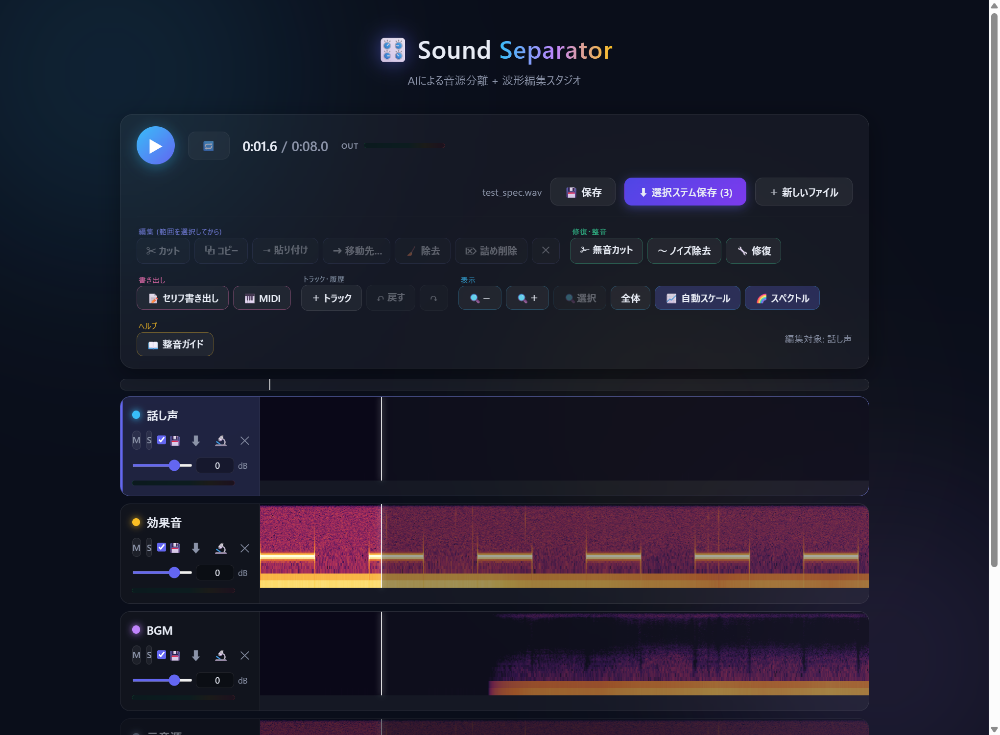
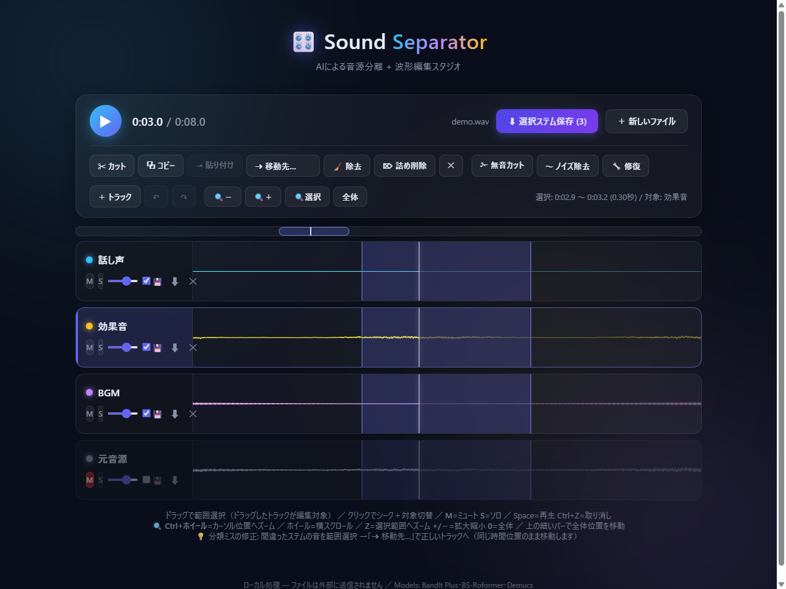
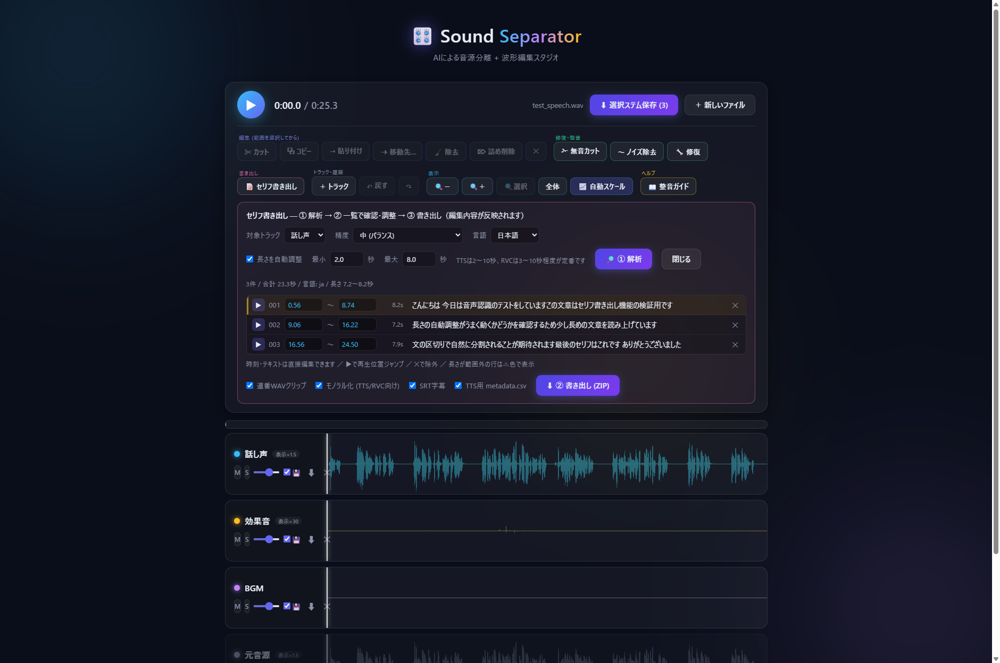
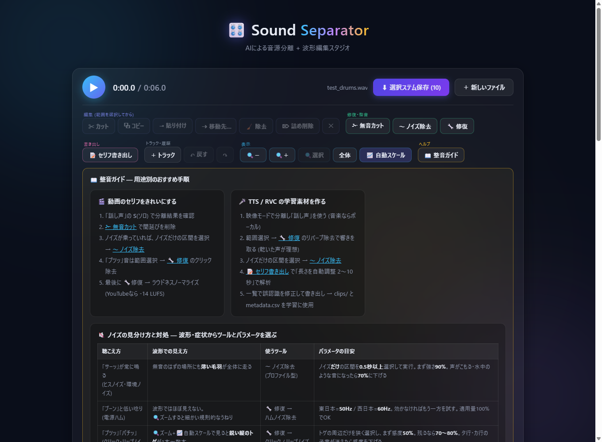

# Sound Separator 🎛️

**[紹介・ダウンロードページ](https://sound-separator.pages.dev/)** · [ZIPをダウンロード](https://github.com/Lida-V/SoundSeparator/archive/refs/heads/main.zip)

音声・動画ファイルをAIでステム分離し、そのままブラウザ上で編集・修復できる**完全ローカル**のWebアプリ。
ファイルは一切外部に送信されません。

Cloudflare上のサイトは紹介・配布用です。AI分離はダウンロードしてセットアップした**各自のPC**で実行します。公開サイトへの音声アップロード機能はありません。

## 2026年11月のアップデート

- **NemotronLabs RE-USE** — 話し声のノイズ・残響などを抑える修復機能。選択範囲をモノラルで処理します。重なった声は主話者以外が抑えられる場合があります。
- **Nemotron-3-Diarization** — 最大8話者の発話区間を推定し、セリフ書き出しの話者ラベルに利用できます。
- **話者・重なりステム** — 文字起こしをせず、話者ごとの単独発話・複数人の重なり・未検出の区間を別トラックに振り分けます。重なった声は混ざったまま残ります。
- **モデル管理** — 必要なモデルを選んでダウンロード。容量・取得状況・必要／推奨環境・配布元を確認できます。処理開始時にモデルを自動取得することはありません。

RE-USEの聴感品質と、話者分離の正解データに対する精度は未評価です。モデルと実機検証の条件は[モデル別の動作環境・容量](#モデル別の動作環境容量)を参照してください。

## 2026年10月のアップデート

- **目的とモデルを選んで分離** — 映像3ステム / 音楽6ステム / ボーカル・伴奏 / 多楽器探索。
- **DBS-TIGER-DnR** — 入力に応じて帯域を分割する、軽量な話し声・効果音・BGMの3分離。出力はモノラルです。
- **MelBand RoFormer** — BS-RoFormerと切り替えてボーカル・伴奏を分離。音楽6ステムの前段にも使用できます。
- **MVSep Mega 53 Stems v1** — 53カテゴリから必要な楽器だけを指定。検索・複数選択に対応。カテゴリが重複するので、結果は最初の1トラックだけを有効にして開きます。アプリが使う公開v1と、MVSepのWeb版改良モデルは別です。
- **5〜60秒の試し分離** — 開始秒と長さを指定し、全編処理の前にモデルとの相性を確認できます。
- **GPU・モデル状態** — GPU名・モデルの使用メモリ・取得済み状態を表示。モデルを切り替えると前段をCPUへ退避し、「モデルメモリ解放」でも解放できます。
- **処理履歴と保存情報** — 同じタブの直近8件を再表示。モデル・プレビュー区間を保存し、サーバーのZIPには `separation.json` が付きます。
- **32bit float WAV** — 書き出しの既定をfloat形式にし、ピークと細部を保持。互換性を重視する場合は16bit PCMも選択できます。プロジェクト保存は常にfloat形式です。

2026年10月に追加したモデルの一次情報、制約、検証範囲は[更新記録](docs/updates-2026-10.md)を参照してください。

以下のスクリーンショットは旧画面の操作例です。現在のモデル管理・話者分離などの表示とは異なります。



## 特徴

- 🎬 **映像・動画音声の3ステム分離** — 話し声 / 効果音 / BGM（BandIt Plus または DBS-TIGER-DnR）
- 🎸 **音楽の6ステム分離** — ボーカル / ドラム / ベース / ギター / ピアノ / その他（BS-Roformer → htdemucs_6s 多段パイプライン）
- ✂️ **波形編集** — カット / コピー / ステム間の移動・貼り付け / 詰め削除 / Undo・Redo
- 🔧 **範囲修復** — クリック・リップノイズ除去 / リバーブ除去 / Nemotron RE-USE / ハム除去 / ノイズプロファイル除去
- 🗣️ **話者・重なりの振り分け** — 単独話者・重なり・未検出の区間をトラックに分ける（Nemotron-3-Diarization）
- 🎨 色分け波形・同期再生・ミュート/ソロ・トラック追加/リネーム
- 🔍 **波形ズーム** — Ctrl+ホイールでカーソル位置へ拡大、サンプル単位まで表示。除去ポイントを正確に狙える
- 📝 **セリフ書き出し** — ローカルAI文字起こし (Whisper) でセリフ単位の連番WAV・SRT字幕・TTS学習用データ・アノテーションを一括生成
- 📦 編集内容を反映した WAV / ZIP 書き出し



## 機能一覧

| 分類 | 機能 |
|---|---|
| 🎬 分離 (映像・動画音声) | 話し声 / 効果音 / BGM の3ステム。BandIt Plusの高品質はアンサンブル、DBSはモノラル軽量処理 |
| 🎸 分離 (音楽) | ボーカル / ドラム / ベース / ギター / ピアノ / その他 の6ステム (多段パイプライン) |
| 🔬 追加分離 | トラック単位でさらに細分化 — ドラム→キック / スネア / タム / シンバル、ボーカル→リード / バックコーラス |
| 🗣️ 話者・重なり | 文字起こしなしで話者の単独発話・重なり・未検出の区間を振り分け。重なりは混合音のまま |
| ✂️ 編集 | カット (トラック単位・尺不変) / コピー / 同位置ミックス貼り付け / ステム間移動 / 除去 / 詰め削除 (全トラック連動) / 無音カット (しきい値・最小長指定) / Undo・Redo 8段 |
| 🔧 修復 | クリック・リップノイズ除去 (感度調整) / リバーブ除去 (AI) / Nemotron RE-USE（声の強調・モノラル）/ ハムノイズ除去 (50/60Hz+倍音) / ノイズプロファイル除去 |
| 🎚️ 整音 | フェードイン・アウト / ピークノーマライズ (-1dB) / ラウドネスノーマライズ (YouTube・Spotify・Apple・TikTok・Podcast・放送プリセット + カスタムLUFS) / **ピッチ変更** (±12半音・トラック単位) / **テンポ変更** (50〜200%・全トラック連動・ピッチ維持) |
| 📦 バッチ | 複数ファイルをまとめてドロップ → 順番に一括分離 → 各ファイルのZIPをダウンロード |
| 📝 セリフ書き出し | ローカルAI文字起こし (3精度・日英+自動判定) / クリップ長の自動調整 / **話者分離** (Resemblyzer または Nemotron-3-Diarization、話者別フォルダ書き出し・一覧で修正可) / 一覧での時刻・テキスト手動修正 / 連番WAVクリップ / SRT字幕 / TTS用 metadata.csv / annotations.json・csv |
| 🎛️ トラック | 追加 (無音トラック) / リネーム (ダブルクリック) / 削除 / ミュート・ソロ・音量 |
| 🔍 表示 | ズーム (Ctrl+ホイール・カーソル中心) / 横スクロール / 選択範囲ズーム / 全体ミニマップ / 波形自動スケール (倍率バッジ) / **スペクトログラム表示切替** / 再生追従 |
| ▶️ 再生 | 同期再生 / クリックシーク / **選択範囲のループ再生** (🔁 / Lキー) |
| 💾 プロジェクト | 編集状態を .ssproj に保存 → ドロップで続きから再開 (トラック・音量・名前・編集すべて復元) |
| 🎹 MIDI書き出し | ローカルAI採譜 (basic-pitch) でトラック→.mid 変換 (感度・最短ノート調整可) |
| 🎚️ ミキサー | 音量はdB表示+数値入力 / トラック別レベルメーター / マスターメーター+クリップ警告 |
| 📦 保存 | ステムごとの💾チェックで選択保存 (ZIP / 単体WAV) / 個別WAV保存。波形の編集内容を反映し、試聴用の音量・ミュート・ソロは反映しない |
| 📖 ガイド | 初回チュートリアル / 用途別整音ガイド (動画セリフ・TTS/RVC素材・ボーカル抜き) / ノイズの見分け方と対処表 (波形の見え方→ツール→パラメータ目安) |
| 🔒 プライバシー | 完全ローカル処理。ファイル・音声は外部送信されません |

## 動作環境

**GPUを選ぶときの出発点は、VRAM 8 GB以上のNVIDIA GPUです。** 歌声分離や音楽6ステムなどを試すための暫定的な目安です。Mega 53を使う場合は、配布元が推奨する**VRAM 16 GB以上**を選んでください。いずれも全モデル・設定での動作保証ではありません。

| 項目 | 必要・推奨環境 |
|---|---|
| OS | Windows 10/11 64bit向け。動作確認はWindowsで実施 |
| GPU | NVIDIA CUDA対応GPUを推奨。通常の音楽・映像分離はVRAM 8 GBを出発点に、Mega 53は16 GB以上を推奨。モデル別の注意は下表を参照。CPU経路もあるが速度・動作はモデルと環境による |
| RAM | 必要・推奨容量は未検証。音源の長さ、ステム数、同時に開くアプリなどで変動 |
| ディスク | Python環境、選んだモデル、入力音源、作業ファイル、出力データの保存領域が必要。モデル本体の容量は下表を参照 |
| その他 | [uv](https://docs.astral.sh/uv/)・[ffmpeg](https://ffmpeg.org/) が PATH にあること。セットアップとモデル取得にはネット接続が必要 |

上記のVRAMはGPUの**搭載容量**の目安です。他のアプリが同じGPUを使う場合は空き容量が少なくなります。VRAM不足時は、他のGPUアプリを終了し、試し分離など短い範囲で確認してください。短くしても不足が解消しない場合があります。

### モデル別の動作環境・容量

表の「アプリの暫定推奨」は、以前の案内や限定的な測定を踏まえた**選択の目安**で、各容量のGPUによる最低要件・長尺音源・全品質設定の検証はできていません。「公式」はモデル提供元による推奨または目安です。**最低VRAMは本アプリでは未検証**です。モデル容量はPython環境や音声の保存領域を含みません。

| モデル・用途 | VRAMの推奨・目安 | モデル本体 | CPU |
|---|---|---:|---|
| BandIt Plus：映像音声3分離 | **6 GB以上**：アプリの暫定推奨。高品質設定はCDX23も使用し、必要量は未検証 | 約149 MB | CPU経路あり、性能未検証 |
| DBS-TIGER DnR：映像音声3分離 | **4 GB以上**：アプリの暫定推奨。モノラル出力 | 約5 MB | CPU経路あり、性能未検証 |
| BS-RoFormer：歌声抽出 | **8 GB以上**：アプリの暫定推奨 | 約640 MB | CPU経路あり、性能未検証 |
| MelBand RoFormer：歌声抽出 | **8 GB以上**：アプリの暫定推奨 | 約913 MB | CPU経路あり、性能未検証 |
| 音楽6ステム：RoFormer + HTDemucs | **8 GB以上**：アプリの暫定推奨。[Demucs公式](https://github.com/facebookresearch/demucs#memory-requirements-for-gpu-acceleration)は単体CLIで最小約3 GB・既定設定で約7 GBと案内 | HTDemucs 約55 MB ＋ RoFormer | CPU経路あり、性能未検証 |
| MVSep Mega 53 v1：多楽器抽出 | **16 GB以上**：[モデル配布元の推奨](https://github.com/ZFTurbo/Music-Source-Separation-Training/releases/tag/v1.0.21) | 約1.37 GB | CPU経路あり、性能未検証 |
| CDX23：BandIt高品質アンサンブル | **推奨容量未確定**。BandItと併用、組合せ時の必要VRAMは未検証 | 約162 MB | CPU経路あり、性能未検証 |
| DrumSep：ドラム細分化 | **6 GB以上**：アプリの暫定推奨 | 約168 MB | CPU経路あり、性能未検証 |
| Karaoke MelBand：リード／バック推定 | **8 GB以上**：アプリの暫定推奨 | 約913 MB | CPU経路あり、性能未検証 |
| MelBand Dereverb：残響除去 | **8 GB以上**：アプリの暫定推奨 | 約913 MB | CPU経路あり、性能未検証 |
| Whisper small／medium／large-v3：文字起こし | **約2／5／10 GB**：[公式のVRAM目安](https://github.com/openai/whisper#available-models-and-languages)。実際は条件で変動 | 約484 MB／1.53 GB／3.09 GB | CPU経路あり、性能未検証 |
| Resemblyzer：話者推定 | **推奨容量未確定** | ライブラリに同梱 | CPU経路あり、性能未検証 |
| Basic Pitch：MIDI採譜 | GPU不要、ONNX RuntimeでCPU処理 | ライブラリに同梱 | CPU処理 |
| NemotronLabs RE-USE：声の強調 | **推奨容量未確定**。本アプリ独自のWindows実装をRTX 4090・合成2秒で実行 | 約39 MB | CPU経路あり、実重みで未検証 |
| Nemotron-3-Diarization：話者分離 | **推奨容量未確定**。Windows・RTX 4090で公式の多話者音声97.6秒の話者割り当てを実行 | 約397 MB | CPU経路あり、実重みで未検証 |

Demucsの公式値は単体CLIに関する案内であり、このアプリの6ステム処理の必要容量を保証するものではありません。RE-USEの[公式対応環境](https://huggingface.co/nvidia/NVIDIA-NemotronLabs-RE-USE)はLinux・NVIDIA Ampere、[Diarizationの公式対応環境](https://huggingface.co/nvidia/Nemotron-3-Diarization)はLinuxとAmpere・Ada・Hopper・Blackwellです。本アプリのWindowsでの実行確認とは区別してください。RE-USEの聴感品質、Diarizationの正解データに対する話者分離精度は未評価です。

#### 暫定推奨の根拠とVRAM実測

旧案内ではBandIt・DrumSepに約4 GB、RoFormer・Karaoke・Dereverbに約6 GB、音楽6ステムに約6 GB・推奨8 GBを掲載していました。ただし算出条件が残っていないため、最低要件ではありません。上表のアプリ独自推奨はこれらを参考に余裕を加えた暫定値です。DBSは下記の短い合成音声での実測を参考にしています。実際の余裕は環境により変わります。

**RTX 4090実測**は、2026年10月26日にWindows・PyTorch 2.6.0+cu124で44.1kHzステレオの合成音声8秒を「高速」処理した際の `torch.cuda.max_memory_allocated()` の最大値です。CUDAコンテキストやPyTorch以外の使用量は含まれず、必要な総VRAMの値ではありません。DBSの標準品質とRE-USEの実測は別途条件を記載しています。

| モデル | 測定時のPyTorchピーク |
|---|---|
| BandIt Plus | 約0.81 GiB割当 |
| BS-RoFormer | 約1.56 GiB割当 |
| 音楽6ステム（BS-RoFormer + HTDemucs） | 約1.56 GiB割当 |
| MVSep Mega 53 v1 | 約3.82 GiB割当（2カテゴリ選択） |
| DBS-TIGER DnR | 約1.13 GiB割当・約1.54 GiB予約（8秒・標準品質） |
| NemotronLabs RE-USE | 約0.98 GiB割当（合成2秒、独自PyTorch実装） |

測定条件と個別の値は[実測記録](docs/benchmarks/vram-rtx4090.json)、再測定の方法は[スクリプト](docs/benchmarks/bench_vram.py)を参照してください。モデルを切り替える際は前段の重みをCPUへ退避し、GPUへの同時常駐を抑えます。「モデルメモリ解放」は分離モデルのキャッシュを解放します（ダウンロード済みファイルは保持。Whisperなど別機能のキャッシュは対象外）。

## セットアップ

Gitを使う場合：

```powershell
git clone https://github.com/Lida-V/SoundSeparator.git
cd SoundSeparator
.\setup.bat
```

Gitを使わない場合は、[ZIP](https://github.com/Lida-V/SoundSeparator/archive/refs/heads/main.zip)をダウンロードして展開し、フォルダ内の `setup.bat` を実行してください。

セットアップではPythonの実行環境と依存パッケージを取得します。Basic PitchとResemblyzerの重みは、それぞれのパッケージに同梱されています。それ以外のモデルは、アプリ起動後に必要なものを明示的に取得してください。取得済みモデルを使った音声処理はローカルで動作します。

`setup.bat` は新規導入向けです。既存の `.venv` がある環境で再実行すると、仮想環境やPyTorchが更新される場合があります。既存のCUDA環境を維持したい場合は、再実行前に内容を確認してください。

### AIモデルのダウンロード

1. `run.bat` で起動し、画面上部の **「AIモデルの管理」** を開きます。
2. 用途・容量の目安・配布元・取得状況を確認し、必要な項目の **「ダウンロード」** を押します。ボタンを押したモデルだけ取得し、進捗とエラーを画面に表示します。
3. 取得済みを確認してから、分離・修復・セリフ解析を実行します。未取得の場合は、処理を開始せず必要なモデルを案内します。取得に失敗したときは原因を確認して再試行できます。

音楽6ステムではボーカルモデルに加えてDemucs、BandItの高品質では追加のアンサンブルモデルが必要です。ドラム細分化・リード／バック分離・リバーブ除去・Whisperの各サイズ・話者分離にもそれぞれ対応するモデルが必要です。Nemotronのモデルや実行環境の条件は、モデル管理に表示される案内と各配布元を確認してください。モデル取得にはインターネット接続が必要です。

以前に取得したWhisperとHTDemucsの重みは、従来のキャッシュからも利用できます。

## 起動

`run.bat` をダブルクリック → ブラウザで http://127.0.0.1:8765 が開きます。

## エージェントから使う（スキル / MCP / CLI）

Claude Code や Codex などのAIエージェントから、画面を開かずに分離・採譜を実行できます。`run.bat` でサーバーを起動しておく必要はありません。導入方法は2つあり、どちらも同じCLIを使います。

| 方法 | 向いている場合 | 導入 |
|---|---|---|
| **スキル**（MCPサーバーなし） | サーバーの登録や承認をせずに使いたい。コマンドを実行できるエージェント | このフォルダを開くだけ。別のフォルダから使うなら `install_skill.py` |
| **MCP** | ツールとして呼びたい。進捗の取得やジョブの取り消しを使いたい | `.mcp.json`（このフォルダ）または `claude mcp add` |

準備は次の2つです。

1. `setup.bat` を済ませる（`.venv` ができていること）。
2. 使うモデルを、アプリ画面の「AIモデルの管理」で取得しておく。CLIとMCPはモデルを取得しません。足りないときはエラーで止まります。

### スキル（MCPサーバーを使わない）

[.claude/skills/soundsep/SKILL.md](.claude/skills/soundsep/SKILL.md) に、CLIの呼び出し方と進め方をまとめたスキルを同梱しています。Claude Code でこのフォルダを開くと、そのまま `soundsep` スキルとして使えます。常駐するプロセスはなく、エージェントが必要なときにCLIを実行します。

別のフォルダで作業するエージェントから使うときは、次のコマンドでユーザーのスキルフォルダへ導入します。このフォルダの場所を書き込んだスキルを1ファイルだけコピーします。

```powershell
.\.venv\Scripts\python.exe -X utf8 tools\install_skill.py
```

| オプション | 導入先 |
|---|---|
| （なし） | `~/.claude/skills/soundsep/`（Claude Code） |
| `--agent codex` | `~/.codex/skills/soundsep/`（Codex） |
| `--dest <フォルダ>` | 指定したスキルフォルダ |
| `--remove` | 導入したスキルを削除 |

同名の別のスキルがある場合は上書きしません。このフォルダを移動したときは、もう一度実行してください。スキルの仕組みがないエージェントには、`SKILL.md` の内容をそのまま指示として渡せます。

### MCP

リポジトリ直下の [.mcp.json](.mcp.json) に、登録名 `soundsep` のサーバーを定義しています。パスはリポジトリからの相対指定なので、**このフォルダをプロジェクトとして開いたとき**に使えます。Claude Code は初回に、プロジェクトのMCPサーバーを有効にするか確認します。

別のフォルダで作業するエージェントから使うときは、絶対パスで登録します（`<フォルダ>` は展開先に置き換えてください）。

```powershell
claude mcp add soundsep -e PYTHONUTF8=1 -e HF_HUB_OFFLINE=1 -- "<フォルダ>\.venv\Scripts\python.exe" -X utf8 "<フォルダ>\tools\soundsep_mcp.py"
```

| ツール | 内容 |
|---|---|
| `soundsep_status` | torch・GPUの空き・モデルの取得状況 |
| `soundsep_models` | モデルごとの取得済みかどうか |
| `soundsep_separate` | ステム分離。`mode` は `music`（6ステム）/ `vocals` / `dme` / `mega` |
| `soundsep_subseparate` | `vocals` をリード／バックへ、`drums` をキック／スネア／シンバル／タムへ |
| `soundsep_midi` | basic-pitch でWAVを採譜してMIDIを書き出す |
| `soundsep_task_status` | ジョブの進捗・結果・ログの末尾 |
| `soundsep_cancel` | 実行中のジョブを止める |

分離・採譜は `task_id` をすぐ返すので、`soundsep_task_status` で完了を待ちます。同時に動かせるジョブは1本です。ジョブの状態とログは `output/_agent_jobs/` に残ります。

### CLI

スキルもMCPも、中身はこのCLIです。スクリプトから直接呼ぶこともできます。結果はJSONで標準出力に、進捗は標準エラーに出ます。

```powershell
.\.venv\Scripts\python.exe -X utf8 tools\soundsep_control.py status
.\.venv\Scripts\python.exe -X utf8 tools\soundsep_control.py separate --input song.wav --out out\song --mode music --quality high --exact
.\.venv\Scripts\python.exe -X utf8 tools\soundsep_control.py subseparate --input out\song\vocals.wav --out out\song_vocals --kind vocals
.\.venv\Scripts\python.exe -X utf8 tools\soundsep_control.py midi --input out\song\bass.wav --out out\song\bass.mid
```

### 出力と注意点

- 出力は入力と同じサンプルレート・長さの32bit float WAVと `manifest.json` です。既存のファイルは上書きしません。出力先には新しいフォルダを指定してください。
- `--exact`（MCPでは `exact`）は「元音源 − 全ステムの和」を `other` に足し、全ステムを足し戻すと元音源に一致するようにします。`music` で全ステムを出すときだけ使えます。
- リード／バック分離の `lead` と `back` の割り当ては、曲や区間によって入れ替わることがあります。`manifest.json` の `window_rms`（5秒ごとの音量）で確認してください。
- 採譜結果には誤りが含まれます。音符の数と音域は結果のJSONで確認できますが、原曲との照合は別途必要です。
- CLIとMCPの動作確認はCUDA対応GPUで行っています。CPUだけでの実行は確認していません。ジョブ管理がWindowsのコマンドを使うため、MCPはWindows専用です。

## 公開サイトの更新

紹介サイトのソースは `site/`、Cloudflare Pages設定は `wrangler.toml` にあります。公開対象は `site/` の静的ファイルのみで、Pythonサーバー・モデル・音声・個人環境の設定は含みません。[再デプロイ手順](docs/deployment.md) を参照してください。

## 使い方

### 1. 分離

1. 目的（映像・動画音声 / 音楽6ステム / ボーカル・伴奏 / 多楽器探索）を選ぶ
2. 分離モデルと品質を選ぶ。多楽器探索は必要な楽器にチェックを入れる
   - 必要なモデルが未取得の場合は、画面上部の「AIモデルの管理」から取得する
3. 短く試す場合はプレビューを有効にし、開始秒と長さ（5〜60秒）を指定する
4. ファイルをドロップ（WAV / MP3 / FLAC / M4A / MP4 / MKV など。動画は音声を自動抽出）。**複数まとめてドロップすると一括分離モード**になり、同じ設定で順番に処理して各ファイルのZIPをダウンロードできます
   - **高速** … プレビュー向き
   - **標準** … 通常はこれで十分
   - **高品質** … 重なりを増やして処理。BandIt Plusでは CDX23 (Demucs4×3) とのアンサンブル。DBSにはCDX23を追加しません

プレビュー結果のエディタ時刻0秒は、指定した開始秒に対応します。全編の元の位置に戻す場合は、結果に表示される開始秒を使ってください。音源の末尾で指定時間に満たない場合は、残りの区間だけを処理します。

**🔬 トラックの追加分離**: 分離後、各トラックの🔬ボタンからさらに細かく分けられます。



- ドラム → **キック / スネア / タム / シンバル** (DrumSep)
- ボーカル・話し声 → **リードボーカル / バックコーラス・ハモリ** (Karaoke Roformer)
- リードとバックの判定は音源によって入れ替わったり混ざったりします。結果を試聴して確認してください
- 元のトラックは残ります (ミュートされ、新トラックが直後に追加されます)
- シンセ・弦・管などは「多楽器を探索」でカテゴリを選択できます。Megaの出力には重複があり、53トラックを加算して元音源を再現する用途には使いません。楽器が存在しない曲でも、無音と完全には判定されない場合があります

**🗣️ 話者・重なり**：エディターで「話者・重なり」を開き、話し声を含むトラックを選んで実行すると、Nemotron-3-Diarizationの推定結果に基づき、話者ごとの単独発話、複数話者の重なり、未検出・その他を別トラックに分けます。文字起こしは必要ありません。あらかじめ「AIモデルの管理」でNemotron-3-Diarizationを取得してください。

これは発話の時間区間による振り分けです。重なりトラックには複数人の声が混ざったまま入り、BGMや効果音も入力に含まれていれば各トラックに残ります。最初に声のトラックを抽出して使うと確認しやすくなります。検出には話者の取り違えや短い発話・重なりの見落としが起こり得るため、結果を試聴して調整してください。境界に短いフェードを入れ、すべての出力を同時再生したときに入力へ近く戻るようにします。元トラックは残り、結果の読み込み後にミュートされます。トラックを追加するためUndo・Redoの履歴はリセットされます。

### 2. 確認・ミックス

- 色分けされた波形で表示。**M**=ミュート / **S**=ソロ
- 音量は**dB単位**でスライダー+数値入力 (−60〜+12dB)。トラックごとに**レベルメーター**、右上に**マスターメーター**があり、音割れすると**CLIPが赤く点灯**します（点いたら音量を下げる）
- 波形は**自動スケール表示**（音の小さいステムも形が見えるよう表示だけ拡大。倍率は「表示×N」バッジに表示、実際の音量は不変。📈ボタンでOFF可）
- 「元音源」トラックはA/B比較用（初期ミュート）
- 波形クリックでシーク、Space で再生/停止
- 初回は画面上に基本の流れ（選択→編集→保存）のガイドが表示されます
- **🔁 ループ再生**（Lキー）: 選択範囲をリピート。修復パラメータの聴き比べに便利
- **🌈 スペクトログラム表示**: 縦=周波数（対数軸・上が高音）、明るさ=音量。ハムは横線、クリックは縦線、ヒスは面のざらつきとして見えるため、ノイズ探しは波形より確実です



- **💾 保存（プロジェクト）**: 編集状態を `.ssproj` ファイルに保存。次回そのファイルをドロップすると、トラック構成・名前・音量・編集内容ごと復元されます

**波形ズーム**（細かいノイズの位置を正確に特定できます）



| 操作 | 動作 |
|---|---|
| Ctrl+ホイール (波形上) | カーソル位置を中心に拡大/縮小 |
| ホイール (波形上・ズーム中) | 横スクロール |
| 🔍＋ / 🔍− ボタン、`+` / `-` キー | 拡大 / 縮小 |
| 🔍選択 ボタン、`Z` キー | 選択範囲へズーム |
| 全体 ボタン、`0` キー | 全体表示に戻す |
| トラック上部の細いバー | 全体ミニマップ。クリック/ドラッグで表示位置を移動 |

サンプル単位まで拡大すると折れ線表示に切り替わり、クリックノイズの位置が正確に見えます。再生中は表示範囲が自動で追従します。

### 3. 編集（ドラッグで範囲選択 → ドラッグしたトラックが編集対象）

| 操作 | 動作 | ショートカット |
|---|---|---|
| ✂ カット | 選択トラックから切り取り（その場は無音、尺不変） | Ctrl+X |
| ⧉ コピー / ⇥ 貼り付け | 貼り付け先トラックをクリックして選び、**元と同じ時間位置**にミックス | Ctrl+C / Ctrl+V |
| ➜ 移動先… | 分類ミスの修正。選択範囲を別トラックへワンクリック移動（例: 効果音に入ったため息を話し声へ） | |
| 🧹 除去 | いらない音をその場で消す（尺・クリップボード不変） | Delete |
| ⌦ 詰め削除 | 全トラックから削除して前後を詰める（尺が縮む） | Shift+Delete |
| ✁ 無音カット | しきい値・最小長を指定して無音区間を自動削除 | |
| ↶↷ Undo / Redo | 8段階 | Ctrl+Z / Ctrl+Y |

すべての編集境界には10msのフェードが自動で入り、クリックノイズを防ぎます。

### 4. 修復（🔧 修復パネル・選択範囲に適用）


- **クリック / リップノイズ除去** — インパルス検出+補間（感度調整可）
- **リバーブ除去** — AIモデル（モデル管理で事前取得、約900MB）
- **Nemotron RE-USE** — 声のノイズや残響などを抑えるモデル。選択範囲をモノラルとして処理し、主話者以外の声も抑える場合があります。モデルと追加環境の準備が必要です。
- **ハムノイズ除去** — 50/60Hz+倍音のノッチフィルタ
- **フェードイン / フェードアウト / ピークノーマライズ(-1dB)**
- **ラウドネスノーマライズ** — 配信プラットフォーム別プリセット（YouTube / Spotify -14、Apple Music / Podcast -16、TikTok -14、テレビ放送 -24 LUFS、カスタム値可）。ITU-R BS.1770準拠の測定でトラック全体を目標値に調整、クリップ防止付き
- **ピッチ変更** — 選択トラック全体を±12半音（0.5刻み）。長さ不変。RVC素材のキー合わせに
- **テンポ変更** — 全トラック連動で50〜200%。ピッチは維持され、尺が変わります（Ctrl+Zで復帰可）
- **〜 ノイズ除去** — ノイズだけの区間を選択→プロファイル学習→トラック全体から除去

### 5. セリフ書き出し（📝 ツールバー）



対象トラック（話し声など）をローカルAI (Whisper) で文字起こしし、以下を一括生成してZIPでダウンロードできます。**編集した内容がそのまま反映されます**。

**① 解析 → ② 一覧で確認・調整 → ③ 書き出し** の流れです。

- **クリップ長の自動調整**: TTS/RVCの学習に適した長さ（最小〜最大秒を指定、既定2〜10秒）に収まるよう、**文の区切り・無音を優先して自動で結合・分割**します。単語レベルのタイムスタンプで分割するのでテキストとの対応が壊れません
- **話者分離**: ResemblyzerまたはNemotron-3-Diarizationでセリフごとの話者を推定します。Resemblyzerは人数指定も可能、Nemotronは最大8人の人数を自動推定します。話者が重なる箇所も一覧の1行には代表者1人を割り当て、推定できない場合は「未判定」と表示します。クリップは**話者別フォルダ**に書き出され、metadata.csvに話者列、SRTに話者名が付きます。判定ミスは一覧の話者セレクトで修正できます。複数話者の会話からTTS/RVC素材を作るときは、話者交代を保つため「長さを自動調整」をオフにするのがおすすめ
- **手動調整**: 解析結果の一覧で、各セリフの**開始/終了時刻・テキスト・話者を直接編集**、✕で除外。範囲外の長さの行は⚠色で警告表示。▶でその位置にジャンプして耳で確認できます

| 出力 | 形式 | 用途 |
|---|---|---|
| `clips/名前_0001.wav` … | セリフ単位の連番WAV（前後0.15秒の余白+フェード付き、モノラル化可） | 素材整理・データセット |
| `subtitles.srt` | SRT字幕（タイムコード+テキスト） | 動画編集ソフトにそのまま読込 |
| `metadata.csv` | `ファイル名\|テキスト`（LJSpeech形式） | TTS（音声合成）の学習データ |
| `annotations.json` / `.csv` | 番号・開始/終了時刻・長さ・テキスト | アノテーション・後処理 |

- 精度は3段階（小/中/大）。言語は自動判定・日本語・英語から選択
- 音声認識モデルは、解析前に「AIモデルの管理」で必要なサイズを取得します（中: 約1.4GB / 大: 約3GB）。話者分離を使う場合は選んだ話者分離モデルも取得してください。
- 検出結果は一覧表示され、行をクリックするとその位置にジャンプ+範囲選択されます（誤認識箇所の確認・修正に便利）

### 6. MIDI書き出し（🎹 ツールバー）

トラックをローカルAI (basic-pitch) で採譜し、MIDIファイルに変換します。ピアノ・ギター・ベース・ボーカルメロディの採譜向き（ドラム・複雑なミックスは不向き。先に分離してから実行を）。感度と最短ノート長を調整できます。

### 7. 整音ガイド（📖 ツールバー）



初心者向けに、用途別のおすすめ手順（動画のセリフ整音 / TTS・RVC学習素材づくり / ボーカル抜き音源）をアプリ内で確認できます。各ステップから該当ツールを直接開けます。ツールバーは機能グループごとに色分けされています（編集=藍 / 修復・整音=緑 / 書き出し=ピンク / 表示=空 / ヘルプ=黄）。

### 8. 書き出し

- 各トラックの **💾チェックボックス** で保存対象を選択 →「⬇ 選択ステム保存」でZIP一括（1つだけならWAV直接保存）
- トラックごとの⬇ボタンで個別WAV保存も可能
- 波形の編集内容は保存されます。ミュート・ソロ・音量フェーダーは試聴用で、個別WAVやZIPにミキサーの音量設定は反映されません

## 使用モデル

| 用途 | モデル | サイズの目安 | 重みのライセンス |
|---|---|---|---|
| 話し声/効果音/BGM | [BandIt Plus](https://github.com/ZFTurbo/Music-Source-Separation-Training) | 約149MB | 未明示 (リポジトリはMIT) |
| 話し声/効果音/BGM（軽量・モノラル） | [DBS-TIGER-DnR](https://huggingface.co/JusperLee/DBS-TIGER-DnR) | 約5MB | Apache-2.0（公式配布表示） |
| ボーカル抽出 | BS-Roformer viperx ep317 | 約640MB | 未明示 (コミュニティ公開) |
| ボーカル抽出（選択式） | [MelBand RoFormer](https://huggingface.co/KimberleyJSN/melbandroformer) | 約913MB | 配布元の条件を参照 |
| 多楽器探索 | [MVSep Mega 53 Stems v1](https://github.com/ZFTurbo/Music-Source-Separation-Training/releases/tag/v1.0.21) | 約1.37GB | 重みの条件は配布元を参照（コードはMIT） |
| 楽器6分割 | htdemucs_6s | 約55MB | MIT |
| 高品質アンサンブル | [MVSEP-CDX23](https://github.com/ZFTurbo/MVSEP-CDX23-Cinematic-Sound-Demixing) ×3 | 約162MB | 未明示 |
| リバーブ除去 | [anvuew MelBand Roformer](https://huggingface.co/anvuew/dereverb_mel_band_roformer) | 約913MB | GPL-3.0 |
| 声の強調・ノイズ／残響抑制 | [NVIDIA NemotronLabs RE-USE](https://huggingface.co/nvidia/NVIDIA-NemotronLabs-RE-USE) | 約39MB | OpenMDW-1.1（配布元を参照） |
| 話者分離 | [Nemotron-3-Diarization](https://huggingface.co/nvidia/Nemotron-3-Diarization) | 約397MB | OpenMDW-1.1（配布元を参照） |
| ドラム細分化 | DrumSep htdemucs (inagoy) | 約168MB | 未明示 |
| リード/バック分離 | MelBand Roformer Karaoke (aufr33/viperx) | 約913MB | 未明示 (コミュニティ公開) |

## ライセンスについて

- **アプリ本体のコード**（下記の同梱コードを除く）: 本リポジトリの作者による独自実装
- **engine/msst/**: [Music-Source-Separation-Training](https://github.com/ZFTurbo/Music-Source-Separation-Training) (MIT License, Roman Solovyev/ZFTurbo氏) を推論用パッチ込みで同梱。LICENSEファイルを保持しています
- **engine/dbs/**: [Dynamic-Band-Splitting](https://github.com/JusperLee/Dynamic-Band-Splitting) の推論用最小コードを固定コミットから同梱。Apache-2.0と第三者コードのMIT表記を保持しています。差分は同フォルダの `README.md` に記録しています
- **app/reuse_runtime/**: [NVIDIA NemotronLabs RE-USE](https://huggingface.co/nvidia/NVIDIA-NemotronLabs-RE-USE) 由来のコードを改変して同梱。OpenMDW-1.1のライセンス、著作権表示と変更内容は[同フォルダ](app/reuse_runtime/README.md)に記載しています
- **AIモデルの重みは本リポジトリに含まれません**。ユーザーが選択したモデルを各配布元から取得し、それぞれの配布条件が適用されます (上表参照)。重みの再配布や、分離結果の商用利用を行う場合は各配布元の条件を必ず確認してください
- 主要依存パッケージ: PyTorch (BSD-3)、FastAPI (MIT)、demucs (MIT)、noisereduce (MIT)、pyloudnorm (MIT)、librosa (ISC) など

## 技術構成

- バックエンド: Python 3.11 / FastAPI / PyTorch（CUDA 12.4系。検証環境は 2.6.0+cu124）
- 分離エンジン: [Music-Source-Separation-Training](https://github.com/ZFTurbo/Music-Source-Separation-Training) (MSST) フレームワーク — `engine/msst/` に推論用軽量化パッチ込みで同梱
- DSP修復: numpy / scipy（declick=微分外れ値検出+補間, dehum=iirnotch）、ノイズ除去: noisereduce
- フロントエンド: Vanilla JS + Web Audio API + Canvas（ライブラリ不使用。編集・WAVエンコード・ZIP生成もクライアントサイド）

```
SoundSeparator/
├── setup.bat / run.bat   … セットアップ / 起動
├── app/
│   ├── server.py         … FastAPI (ジョブ管理 / denoise / effect API)
│   ├── separator.py      … 分離エンジン (モデル遅延ロード+キャッシュ)
│   ├── model_downloads.py … モデルの取得・状態管理
│   ├── transcriber.py    … 文字起こし・話者区間の推定
│   ├── diarization_stems.py … 単独・重なり・未検出の時間振り分け
│   ├── reuse_adapter.py  … RE-USEによる音声強調
│   ├── repair.py         … DSP修復
│   └── static/           … フロントエンド
├── tools/                … エージェント向けCLI (soundsep_control.py)、MCPサーバー (soundsep_mcp.py)、スキル導入 (install_skill.py)
├── .claude/skills/soundsep/ … エージェント用スキル (MCPなしでCLIを使う手順)
├── .mcp.json             … MCPサーバーの登録 (相対パス)
├── engine/msst/          … MSST フレームワーク (パッチ済み同梱)
├── models/               … モデルチェックポイント (手動取得・git管理外)
└── output/               … 分離結果 (git管理外)
```

### テスト

```powershell
.\.venv\Scripts\python.exe -m unittest discover -s tests -v
```

テストはモデルを自動ダウンロードしません。取得済み重みとCUDAがある場合は一部のGPU動作確認も実行し、それ以外はスキップします。合成音声の検証結果は、実際の音源を使った聴感評価や分離精度の測定とは異なります。

### MSST への加えたパッチ

推論に不要な学習用依存 (asteroid / pytorch_lightning など) を避けるため:

- `engine/msst/models/bandit/core/__init__.py` … 学習用コードを空に
- `engine/msst/models/bandit/core/model/bsrnn/wrapper.py` … LightningModule → nn.Module
